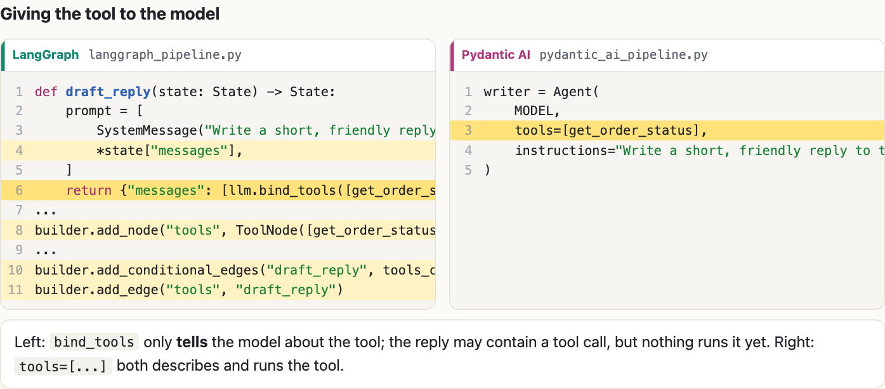
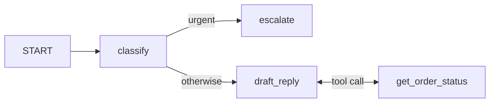
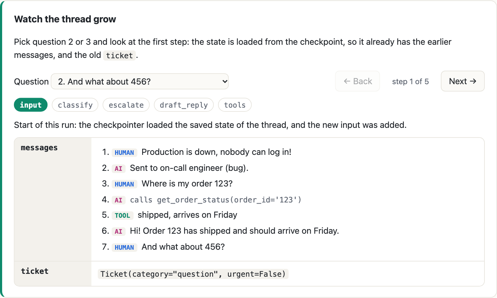

<div align="center">

# 🧩 LangGraph & Pydantic AI, side by side

**Learn both libraries by building the same LLM pipeline in each, next to each other.**

A free, interactive course: linked code side by side, a state stepper that replays real runs of the graph, quizzes,
coding exercises and cheat cards. Nothing to install, no API key needed to read it.

[](https://romanzdk.github.io/langgraph-and-pydantic-ai/)

[](https://github.com/romanzdk/langgraph-and-pydantic-ai/actions/workflows/check.yml)
[](LICENSE)


</div>



## Why this course

LangGraph and Pydantic AI are two popular ways to build LLM pipelines in Python. Each has good docs, but they
explain the library on its own. When you have to pick one, or use both, you want to see them **next to each other**:
the same idea written two ways, and the places where they really think differently.

So this course builds one small pipeline twice. A support ticket comes in, an LLM classifies it, urgent tickets go to
the on-call engineer, and the rest get a reply written by the LLM, which can look up an order with a tool:



Then it grows: memory across questions, both libraries in one graph, tests without an API key, a person approving
refunds, streaming and evals. Then it goes wrong on purpose: timeouts, a tool loop that never ends, a crash in the
middle of a refund, another customer's order, and a prompt injection hidden in a tool result.

## How a lesson works

| | |
|---|---|
| **Side by side** | LangGraph on the left, Pydantic AI on the right. Hover over or tap a marked line to light up the matching line on the other side and read a short note. |
| **Where they differ** | The places where the two libraries really think differently, and the mistakes we hit while building the examples. |
| **Step through the state** | Replay a recorded run of the real graph, node by node, and see exactly which keys each node changed. |
| **Check yourself** | A few short questions with explanations. |
| **Exercise** | Some lessons end with a small change to make in [`exercises/`](exercises), checked by a test with fake models. |
| **Cheat card** | A LangGraph ↔ Pydantic AI lookup table for the topic. The [cheat sheet](https://romanzdk.github.io/langgraph-and-pydantic-ai/#/cheatsheet) puts every card on one searchable page. |

<p align="center"></p>

## Lessons

**Get started**

| # | Lesson | What you learn |
|---|---|---|
| 1 | [The task, the setup and the model](https://romanzdk.github.io/langgraph-and-pydantic-ai/#/setup) | What each library is for, `provider:model` strings, OpenRouter |

**Build the pipeline**

| # | Lesson | What you learn |
|---|---|---|
| 2 | [Structured output](https://romanzdk.github.io/langgraph-and-pydantic-ai/#/structured-output) | Get a Pydantic model back, and why a forced `tool_choice` breaks with Claude 5.5 |
| 3 | [Branching: edges or an if](https://romanzdk.github.io/langgraph-and-pydantic-ai/#/branching) | Conditional edges vs. a plain `if`, and why the router is not a step |
| 4 | [State: what travels between steps](https://romanzdk.github.io/langgraph-and-pydantic-ai/#/state) | The shared `State`, reducers, and how long state lives |
| 5 | [Tools: let the LLM look things up](https://romanzdk.github.io/langgraph-and-pydantic-ai/#/tools) | `ToolNode` + `tools_condition` vs. `Agent(tools=[...])` |

**Beyond one run**

| # | Lesson | What you learn |
|---|---|---|
| 6 | [Memory: continue the conversation](https://romanzdk.github.io/langgraph-and-pydantic-ai/#/memory) | Checkpointer + `thread_id` vs. `message_history` |
| 7 | [Both together: a graph of agents](https://romanzdk.github.io/langgraph-and-pydantic-ai/#/combined) | A LangGraph graph whose nodes call Pydantic AI agents |

**Ship it**

| # | Lesson | What you learn |
|---|---|---|
| 8 | [Testing without an API key](https://romanzdk.github.io/langgraph-and-pydantic-ai/#/testing) | Fake chat models vs. `FunctionModel` and `Agent.override` |
| 9 | [Human in the loop](https://romanzdk.github.io/langgraph-and-pydantic-ai/#/human-in-the-loop) | `interrupt()` + `Command(resume=...)` vs. `requires_approval` + `DeferredToolResults` |
| 10 | [Streaming](https://romanzdk.github.io/langgraph-and-pydantic-ai/#/streaming) | `graph.stream` modes vs. `run_stream_sync` |
| 11 | [Evals](https://romanzdk.github.io/langgraph-and-pydantic-ai/#/evals) | One `pydantic_evals` dataset that scores both classifiers |

**When it goes wrong**

| # | Lesson | What you learn |
|---|---|---|
| 12 | [When things fail](https://romanzdk.github.io/langgraph-and-pydantic-ai/#/failures) | Retries, output validators, tool budgets, resuming from SQLite, refunds that are safe to run twice |
| 13 | [Safe tools](https://romanzdk.github.io/langgraph-and-pydantic-ai/#/safe-tools) | `ToolRuntime` context vs. `RunContext` deps, permission checks in Python, prompt injection |
| 14 | [Evals of the whole run](https://romanzdk.github.io/langgraph-and-pydantic-ai/#/full-evals) | Right tool, grounded replies, no leaks, no unapproved refunds; tokens, and a prompt comparison |

**Wrap up**

| # | Lesson | What you learn |
|---|---|---|
| 15 | [Which one should I use?](https://romanzdk.github.io/langgraph-and-pydantic-ai/#/which-one) | When plain Python is enough, when Pydantic AI, when LangGraph, when both |

## Run the examples

Every snippet on the site comes from [`examples/`](examples). The models go through
[OpenRouter](https://openrouter.ai), so one key works for Claude, GPT, DeepSeek and others.

```sh
git clone https://github.com/romanzdk/langgraph-and-pydantic-ai.git
cd langgraph-and-pydantic-ai
uv sync
export OPENROUTER_API_KEY=...

uv run examples/langgraph_pipeline.py     # the pipeline in LangGraph
uv run examples/pydantic_ai_pipeline.py   # the same in Pydantic AI
uv run examples/combined_pipeline.py      # LangGraph graph, Pydantic AI agents
uv run examples/hitl_langgraph.py         # asks you to approve a refund
uv run examples/streaming_pydantic_ai.py  # the reply token by token
uv run examples/evals.py                  # scores both classifiers
uv run examples/failures_langgraph.py     # run it, kill it with Ctrl+C, run it again
uv run examples/safe_tools_pydantic_ai.py # tries other customers' orders and an injection
uv run examples/evals_full.py             # scores the whole run, then compares two prompts
```

No API key? Run everything with fake models:

```sh
cd examples && uv run check_offline.py
```

To use another model, change `anthropic/claude-haiku-5.5` to any [OpenRouter model ID](https://openrouter.ai/models).

## Exercises

Edit a file in [`exercises/`](exercises), then check it. The checks use fake models, so no API key is needed:

```sh
uv run exercises/check.py tool_limit        # lesson 12: stop a tool loop
uv run exercises/check.py refund_once       # lesson 12: a refund that is safe to run twice
uv run exercises/check.py own_orders_only   # lesson 13: take the customer from the app
```

Solutions are in [`exercises/solutions/`](exercises/solutions). Try first.

## Every example is checked

A course is only useful if its examples are right, so CI checks everything on every push, and deploys the site only
when all checks pass:

- **Every example runs** with fake models ([`examples/check_offline.py`](examples/check_offline.py)): both branches,
  the tool round, memory across questions, approving and rejecting a refund, streaming, the evals, a crash in the
  middle of a refund, other customers' orders and injected instructions.
- **Every exercise is solvable** ([`exercises/check.py`](exercises/check.py)): each solution passes its check, and
  each unsolved exercise still fails it.
- **The stepper is a real run.** [`scripts/trace.py`](scripts/trace.py) runs the real graphs and records the state
  after every step. Only the reply texts are canned. CI fails if the recording is out of date, or if a new
  conversation starts with state left over from another one.
- **Every snippet matches the code.** [`scripts/check.mjs`](scripts/check.mjs) fails if a snippet in a lesson is not
  found word for word in `examples/`, if a line link points at the wrong line or hides another one, or if a quiz
  answer is invalid.

The examples were also run against the real API (Claude Haiku 5.5 through OpenRouter) when each lesson was written.

## Run the site locally

It is a static site with no build step:

```sh
python3 -m http.server 8000   # then open http://localhost:8000
node scripts/check.mjs        # check the lessons
node scripts/build-pages.mjs  # build the deployed site into _site/ (a page per lesson + sitemap)
```

## Contributing

Found a mistake or an outdated API, or have an idea for a lesson?
[Open an issue](https://github.com/romanzdk/langgraph-and-pydantic-ai/issues/new/choose).
To change or add a lesson, see [CONTRIBUTING.md](CONTRIBUTING.md). The design notes are in
[docs/design.md](docs/design.md).

## License

[MIT](LICENSE) © Roman Žydyk
