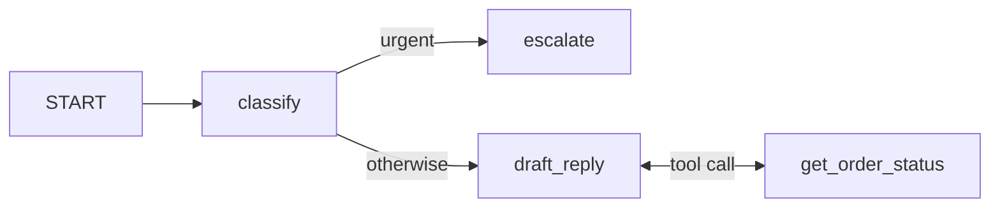

# LangGraph & Pydantic AI, side by side

**Learn both libraries by building the same small LLM pipeline in each, next to each other.**

👉 **[Open the course](https://romanzdk.github.io/langgraph-and-pydantic-ai/)**: free, nothing to install.

The pipeline: a support ticket comes in → an LLM classifies it (`category`, `urgent`) → urgent tickets go to the
on-call engineer, the rest get a reply written by the LLM, which can look up an order with a tool. Later it also
remembers the conversation.



## Lessons

| # | Lesson | What you learn |
|---|---|---|
| 1 | [The task, the setup and the model](https://romanzdk.github.io/langgraph-and-pydantic-ai/#/setup) | What each library is for, `provider:model` strings, OpenRouter |
| 2 | [Structured output](https://romanzdk.github.io/langgraph-and-pydantic-ai/#/structured-output) | Get a Pydantic model back, and why a forced `tool_choice` breaks with Claude 5.5 |
| 3 | [Branching](https://romanzdk.github.io/langgraph-and-pydantic-ai/#/branching) | Conditional edges vs. a plain `if` |
| 4 | [State](https://romanzdk.github.io/langgraph-and-pydantic-ai/#/state) | The shared `State`, reducers, and how long state lives |
| 5 | [Tools](https://romanzdk.github.io/langgraph-and-pydantic-ai/#/tools) | `ToolNode` + `tools_condition` vs. `Agent(tools=[...])` |
| 6 | [Memory](https://romanzdk.github.io/langgraph-and-pydantic-ai/#/memory) | Checkpointer + `thread_id` vs. `message_history` |
| 7 | [Both together](https://romanzdk.github.io/langgraph-and-pydantic-ai/#/combined) | A LangGraph graph whose nodes call Pydantic AI agents |
| 8 | [Testing without an API key](https://romanzdk.github.io/langgraph-and-pydantic-ai/#/testing) | Fake chat models vs. `FunctionModel` and `Agent.override` |

Each lesson has side-by-side code with linked lines, a "where they differ" box, a **state stepper** that replays a
real run of the graph node by node, a few questions, and a cheat card.

## Run the examples

```bash
uv sync
export OPENROUTER_API_KEY=...
uv run examples/langgraph_pipeline.py
uv run examples/pydantic_ai_pipeline.py
uv run examples/combined_pipeline.py
```

Without an API key (fake models, checks both branches, the tool and the memory):

```bash
cd examples && uv run check_offline.py
```

## How it is checked

| Check | What it guarantees |
|---|---|
| `examples/check_offline.py` | All three pipelines take both branches, use the tool and remember the conversation |
| `scripts/trace.py` + `git diff` | The stepper data is a real run of the current graphs |
| `scripts/check.mjs` | Every snippet in a lesson is copied word for word from `examples/`, line links and quiz answers are valid |

The site is plain HTML, CSS and JS with no build step. Open `index.html` in a browser to work on it.

## License

MIT
